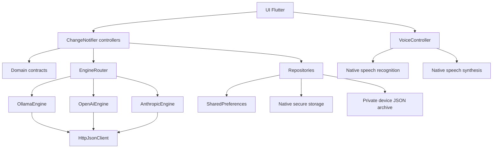

# Architecture OPENUS — phase 1

## Principes

1. Flutter est la seule interface applicative ; Android et Windows partagent le code Dart.
2. Les contrats du domaine ne dépendent ni des widgets ni des plugins natifs.
3. Les adaptateurs réseau implémentent `AiEngine`. Aucun adaptateur « démo » n’est enregistré en production.
4. Les contrôleurs orchestrent les opérations ; les widgets ne contactent pas directement une API IA.
5. Les préférences, les credentials et les conversations ont des stockages distincts.
6. Toute disponibilité est inconnue au départ. Une configuration enregistrée n’est pas une preuve de disponibilité.

## Graphe de dépendances

`OpenUsBootstrap` est le point de composition. Il ouvre le stockage, crée les dépôts et adaptateurs, puis injecte les contrôleurs avec Provider. En cas d’échec d’ouverture du stockage, un écran d’erreur avec réessai est affiché au lieu de prétendre que l’application est prête.

## Cycle d’une requête

1. L’utilisateur valide explicitement son message.
2. `ConversationController` ajoute le message et une réponse en attente, puis tente la persistance locale.
3. Le routeur reçoit un instantané des paramètres et le contexte de la conversation active.
4. En local/auto, Ollama est interrogé via `/api/tags`. Le modèle doit figurer dans la réponse réelle.
5. Si nécessaire et autorisé par le mode, le fournisseur Internet configuré est sélectionné. Sa clé est lue à ce moment seulement.
6. L’adaptateur envoie une requête non streamée. Le client HTTP est propre à la requête ; l’annulation le ferme réellement.
7. La réponse remplace l’état en attente. Une erreur devient un message d’échec explicite, jamais une réponse inventée.
8. La conversation est sauvegardée. Un échec disque conserve les données en mémoire et affiche un avertissement.

Une seule génération est autorisée à la fois. Changer de conversation ne déplace pas la réponse vers une autre conversation. Une réponse tardive ne recrée pas un échange supprimé. Les réponses en attente restaurées depuis le disque deviennent « annulées ».

## Routage et vérité de l’état

- **Local** : aucun repli Internet, même si une clé est enregistrée.
- **Internet** : aucun appel Ollama ; fournisseur sélectionné uniquement.
- **Auto** : Ollama disponible d’abord, sinon fournisseur configuré. Pas de nouveau fournisseur après une erreur de génération, afin d’éviter double facturation et transmission imprévue.
- Une vérification cloud interroge la liste des modèles. Certaines clés peuvent avoir accès au chat mais pas à cette liste : un échec de vérification ne prouve pas toujours que le chat soit interdit. L’application n’affiche « vérifié » qu’après un succès réel.
- Les modèles cloud ne sont pas présélectionnés avec des identifiants supposés disponibles pour le compte.

## Stockage

### Conversations

`JsonConversationRepository` utilise le répertoire de support applicatif fourni par `path_provider`. Le document contient `schemaVersion: 1` et la liste des conversations. Chaque écriture capture immédiatement son instantané, attend la précédente, écrit un fichier temporaire avec flush puis le renomme. Les écritures ne sont pas parallèles.

Un archive illisible n’est ni supprimée ni écrasée silencieusement. L’utilisateur peut continuer en mémoire avec avertissement. Une suppression explicite confirmée peut remplacer l’archive. La migration de schéma, le chiffrement de l’archive et la pagination restent à développer pour de très grands historiques.

### Paramètres

`shared_preferences` contient uniquement les choix non sensibles. Les valeurs inconnues reviennent à des défauts sûrs. Les erreurs de sauvegarde sont affichées.

### Credentials

`CredentialStore` isole le stockage natif. Une erreur n’entraîne aucun repli en clair. L’état de l’interface conserve seulement la présence d’une clé par fournisseur, pas sa valeur. Les credentials ne sont pas sérialisés dans les conversations ou les paramètres.

## Mémoire

`ConversationContext.build` sélectionne les derniers messages terminés,exclut les erreurs et commencements orphelins, et commence sur un tour utilisateur. Le contexte ne traverse jamais les conversations. La limite par défaut est de 20 messages, configurable de 4 à 40.

Il n’y a pas de base vectorielle, de résumé automatique, de profil utilisateur ou de rappel à long terme dans cette phase.

## Voix

`VoiceController` encapsule `speech_to_text` et `flutter_tts`. La dictée insère le texte dans le compositeur ; elle ne l’envoie pas automatiquement. L’utilisateur peut relire/corriger. La lecture automatique est désactivée par défaut. Les permissions sont demandées par le plugin lors d’une action explicite.

Les services système peuvent être absents, refusés ou nécessiter le réseau. La reconnaissance Windows du plugin est expérimentale. Aucun audio n’est persisté par OPENUS. Les opérations vocales ne sont pas des moteurs IA conversationnels.

## Ajouter un fournisseur

1. Ajouter son contrat de configuration non sensible et son emplacement de credential.
2. Implémenter `AiEngine.probe` et `AiEngine.complete` dans `services/ai/`.
3. Utiliser `HttpJsonClient` ou un transport dédié testable ; normaliser les erreurs sans divulguer les secrets.
4. Enregistrer l’adaptateur dans le point de composition/routeur, jamais dans un widget.
5. Ajouter les choix de paramètres et les tests de schéma, d’authentification, d’absence de réponse et d’annulation.
6. Vérifier les plateformes natives avant d’ajouter une dépendance.

Pour llama.cpp embarqué, prévoir un adaptateur FFI isolé, la gestion du cycle de vie du modèle, la sélection ABI Android/x64 Windows, la mémoire requise et le stockage des poids hors Git. Aucun faux moteur llama.cpp n’est présent.

## Tests et extension

Les doublures sont confinées à `test/`. Les tests couvrent les contrats, les schémas HTTP, le routage, la persistance, les erreurs et les layouts. La CI compile réellement Android et Windows. Les essais de microphone, TTS, keystore matériel, Ollama LAN et comptes API restent manuels.

Prochaines évolutions recommandées : streaming avec annulation, rendu Markdown sûr, migration/chiffrement de l’historique, tests d’intégration sur appareils, signature et distribution, mémoire sémantique explicitement consentie, puis outils système à permissions strictes.
